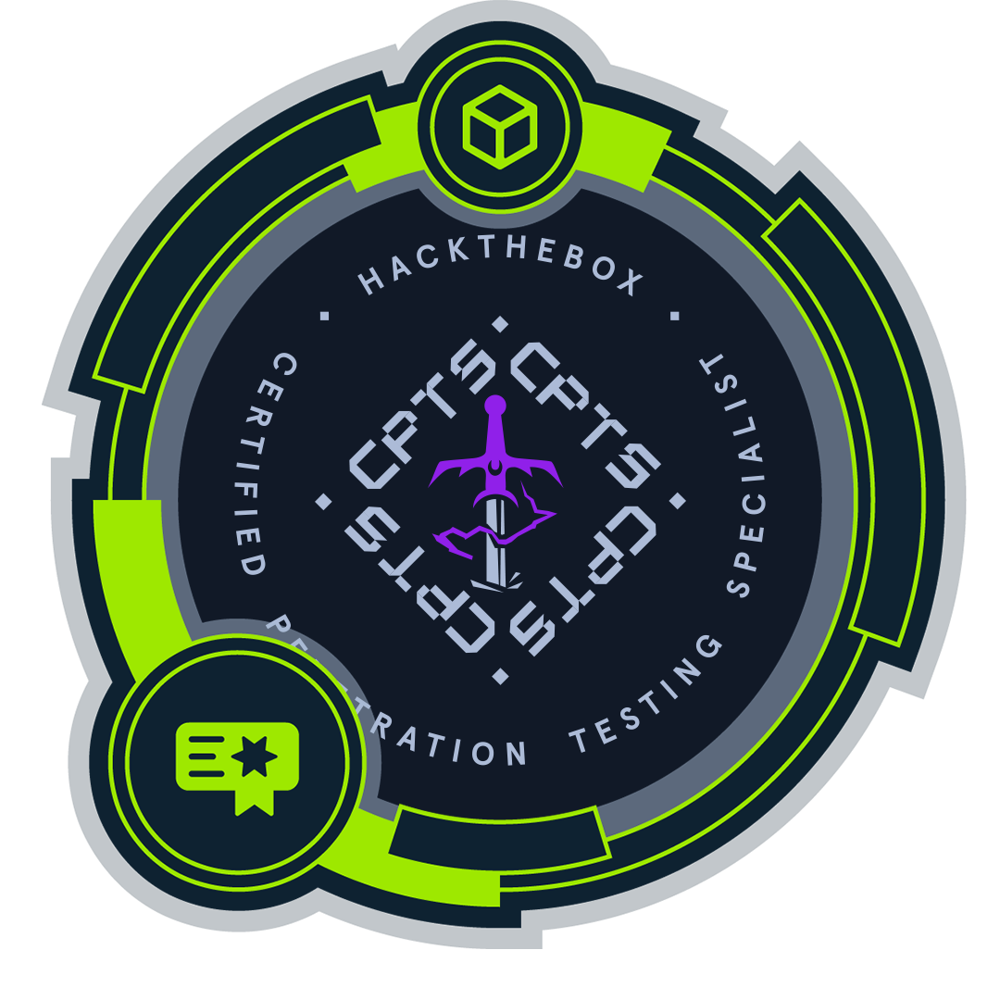
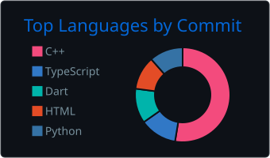
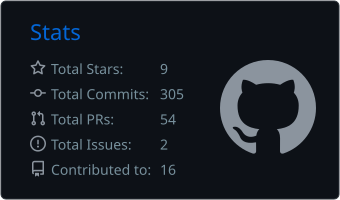

<h1 align="center">Hey There 👋😎, Nice to see you. I'm Zayd Ben Fadhel</h1>

  <h1><code><strong>$ whoami</strong></code></h1>

  

<h3 align="center">
  ICT engineering student at Sup'Com, passionate about building impactful tech projects and exploring the world of CyberSecurity.
</h3>

  
  &nbsp;
  

---

  

---

- 🌱 I’m currently learning **Everything**
- 📝 I write about security and what I learn on my **[Notion blog](https://x4yd.notion.site/x4yd-2f2ad571afa581188ce7fd530973f5e6)**
- My **sleep** schedule ??? Somewhere between “just one more **commit**” and fixing that last **bug** 🐞.... usually by the time the **sun** decides to show up 🌄

---
<h3 align="center">Connect with me:</h3>

  
  &nbsp;&nbsp;&nbsp;
  
  &nbsp;&nbsp;&nbsp;
  
  &nbsp;&nbsp;&nbsp;
  

---

<h3 align="center">💻 Languages:</h3>

  
  &nbsp;&nbsp;&nbsp;
  
  &nbsp;&nbsp;&nbsp;
  
  &nbsp;&nbsp;&nbsp;
  
  &nbsp;&nbsp;&nbsp;
  
  &nbsp;&nbsp;&nbsp;
  
  &nbsp;&nbsp;&nbsp;
  

<h3 align="center">🧩 Frameworks & Libraries:</h3>

  
  &nbsp;&nbsp;&nbsp;
  
  &nbsp;&nbsp;&nbsp;
  
  &nbsp;&nbsp;&nbsp;
  

<h3 align="center">🔧 Tools & Platforms:</h3>

  
  &nbsp;&nbsp;&nbsp;
  
  &nbsp;&nbsp;&nbsp;
  
  &nbsp;&nbsp;&nbsp;
  
  &nbsp;&nbsp;&nbsp;
  

---

<h3 align="center">📊 GitHub Stats:</h3>

  
  

  

